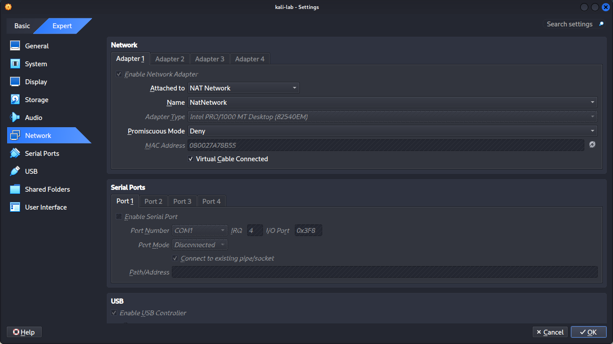
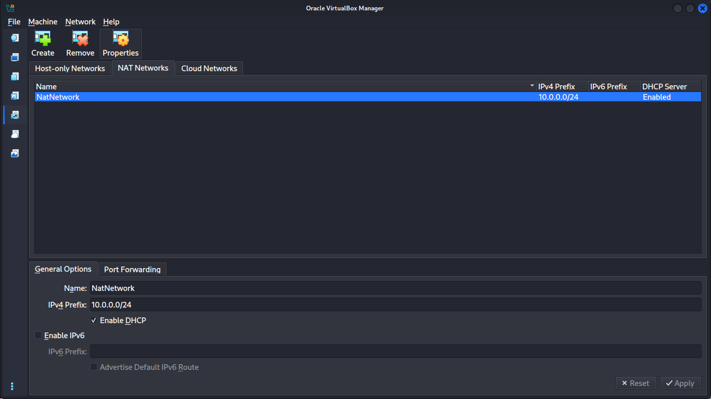
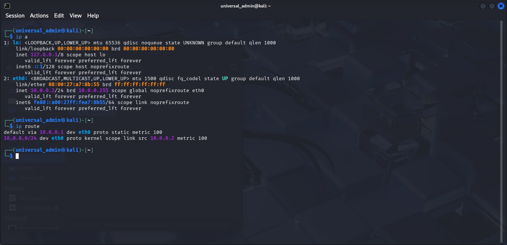
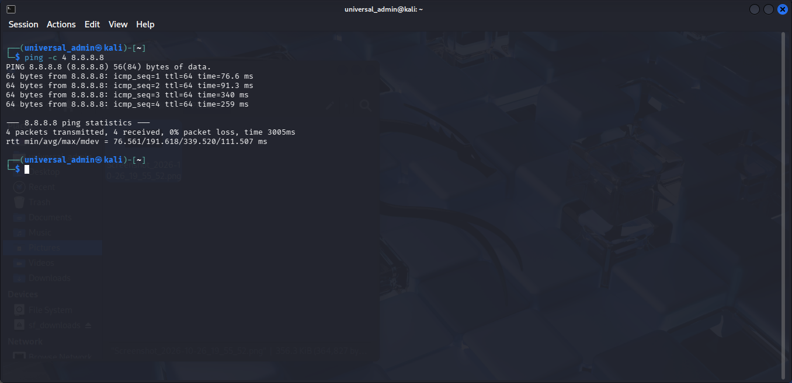
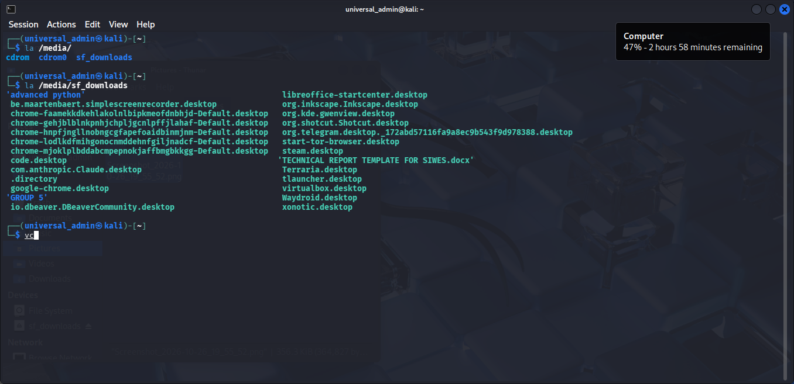
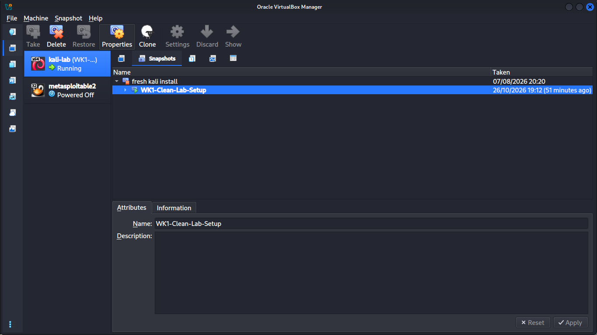

# NETWORKWALKS-Zaharan-Siaka-B084-WK1-PM1-CYBERSECURITY-LAB-SETUP

## Student Information
- Name: Siaka Zaharan Onoruoiza
- Batch: B084
- Project: WK1-PM1 – Cybersecurity Lab Setup

---

## Project Objective
Setup a complete Cybersecurity testing lab environment using VirtualBox and Kali Linux for ethical hacking and security practice.

---

## Lab Requirements Completed

| Requirement                        | Status     |
|------------------------------------|------------|
| VirtualBox installed               | ✅ Completed |
| Kali Linux installed               | ✅ Completed |
| NAT Network (10.0.0.0/24)          | ✅ Completed |
| Kali IP Address: 10.0.0.2/24       | ✅ Completed |
| Full Internet Access               | ✅ Completed |
| Shared Folder (/downloads)         | ✅ Completed |
| Clipboard (Bidirectional)          | ✅ Completed |
| Drag and Drop (Bidirectional)      | ✅ Completed |
| Snapshot taken                     | ✅ Completed |

---

## Network Configuration

- Network Type: NAT Network
- Network Name: NatNetwork
- Subnet: 10.0.0.0/24
- Kali Linux IP: 10.0.0.2/24
- Gateway: 10.0.0.1
- DNS: 8.8.8.8 / 1.1.1.1

---

## Steps Performed

1. Installed VirtualBox
2. Created NAT Network with subnet 10.0.0.0/24
3. Imported / Installed Kali Linux
4. Configured network adapter to NAT Network
5. Assigned static IP 10.0.0.2/24 to Kali
6. Enabled Shared Folder (downloads)
7. Enabled Bidirectional Clipboard and Drag & Drop
8. Verified full internet connectivity
9. Took a clean snapshot named WK1-Clean-Lab-Setup

---

## Screenshots
## Screenshots

1. Network Adapter Settings  
   

2. NAT Network Configuration  
   

3. Kali IP Address  
   

4. Internet Test  
   

5. Shared Folder  
   

6. Snapshot  
   

6. Drag And Drop (Bidirectional) 
   

---

## Notes
- Host machine was initially not connected to the internet, which caused temporary connectivity issues. After connecting the host to a hotspot, internet access worked properly.
- All official requirements for WK1-PM1 have been successfully completed.

---

Submitted by: Siaka Zaharan Onoruoiza  
Batch: B084  
Date: October 2026
